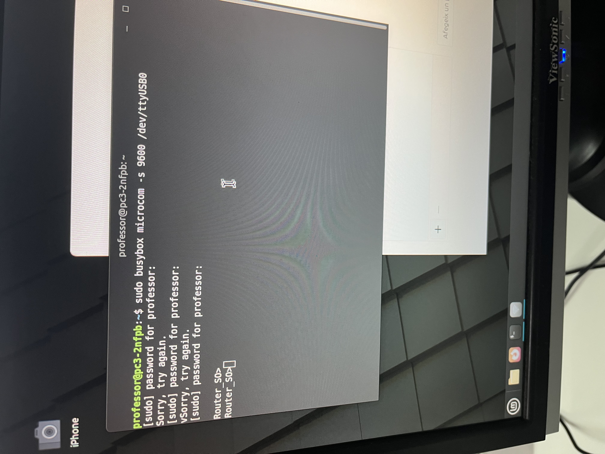
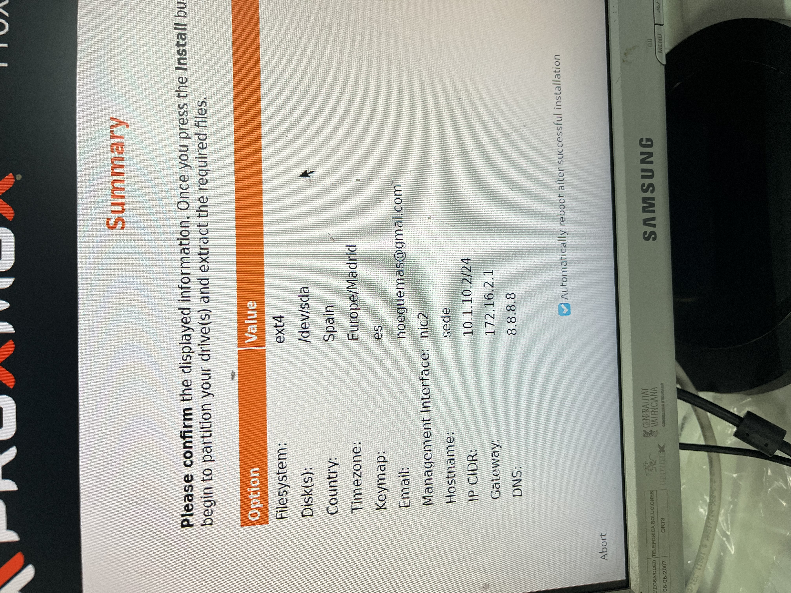
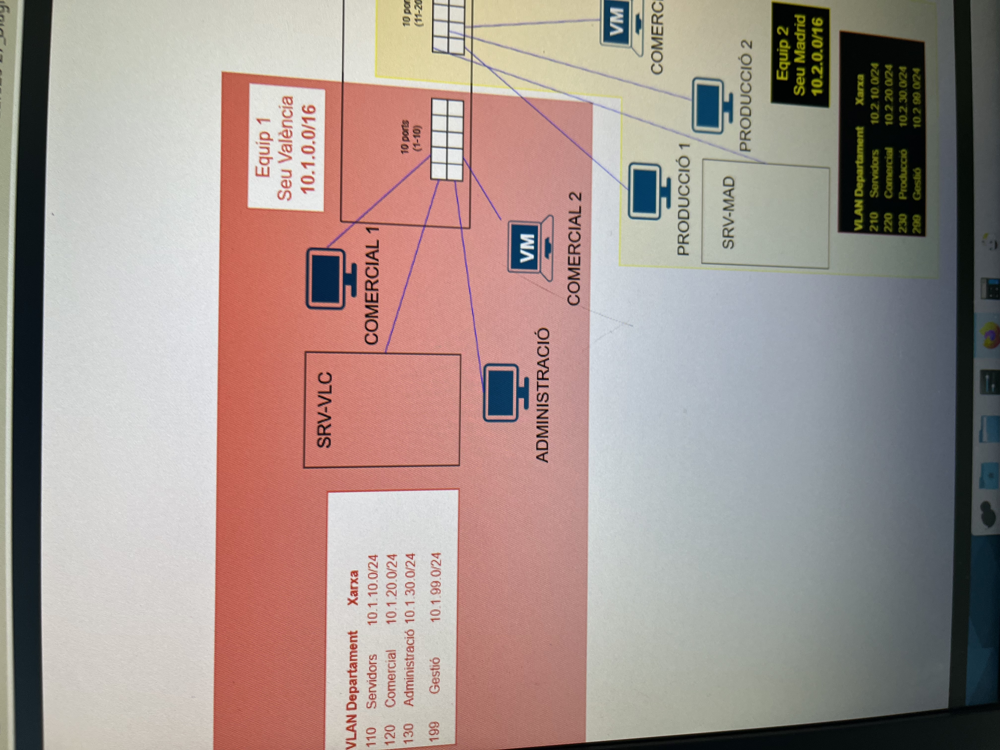
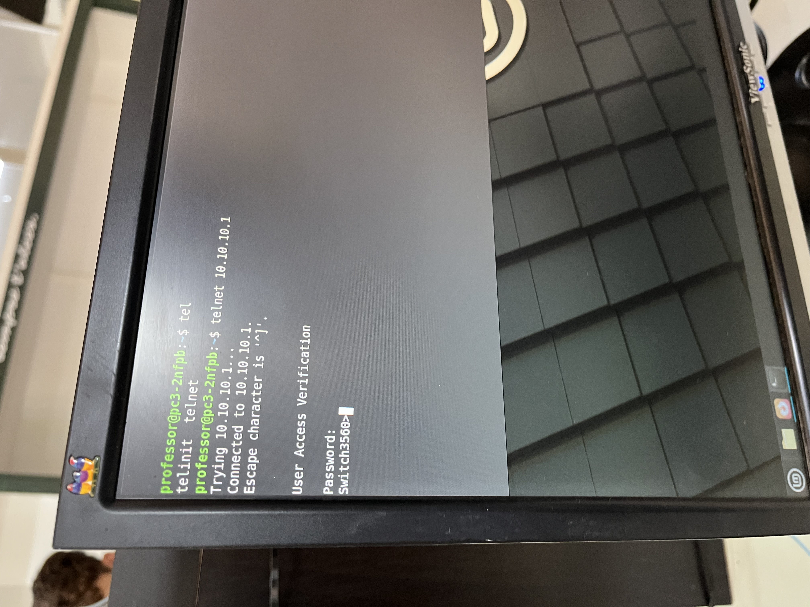
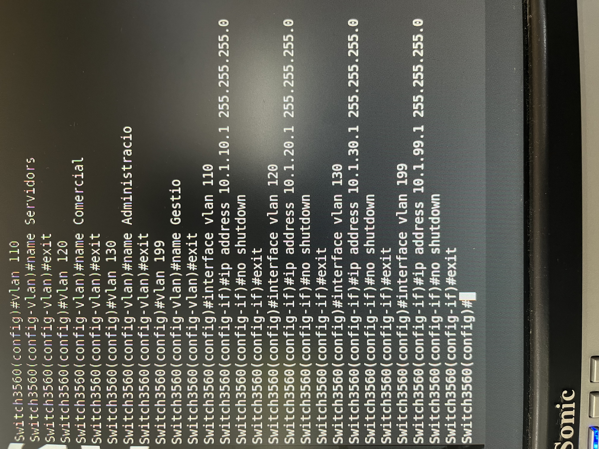
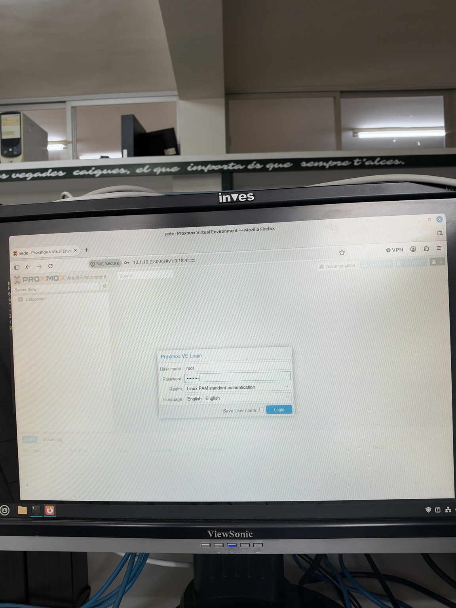
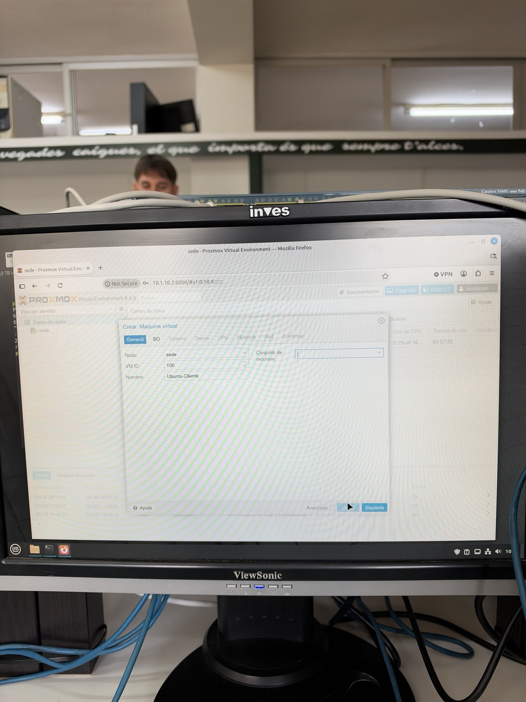
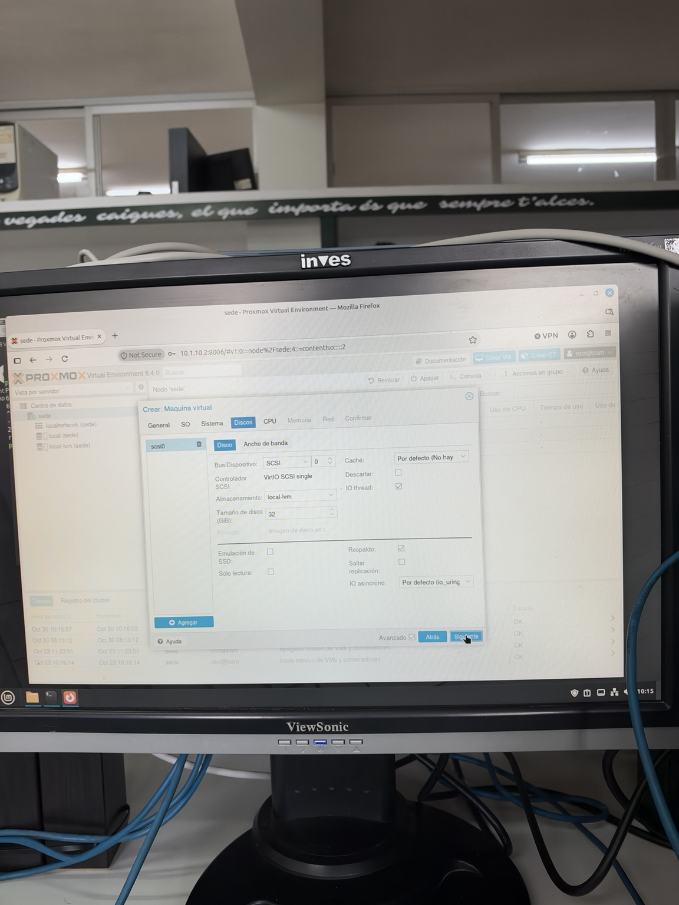

# Bitàcora setmanal

## Setmana 1

### Objectiu del grup

Organitzar el grup de treball i assignar els diferents rols per a començar el projecte.

### Treball realitzat

Durant aquesta primera setmana ens hem centrat en l'organització inicial del grup. 
Hem revisat els diferents rols que hi havia dins del projecte i les funcions de cadascun:

- Cap de projecte
- Secretari
- Responsable tècnic

També hem decidit els substituts de cada rol.

Com que al principi no ens posàvem d'acord sobre l'assignació dels rols, vam decidir fer-ho mitjançant un sorteig per a repartir-los de manera aleatòria.

Finalment, els rols van quedar assignats entre els membres del grup.

### Què hem aconseguit

- Organitzar el grup de treball.
- Assignar els tres rols principals.
- Assignar un substitut per a cada rol.
- Deixar preparada l'organització inicial per començar el projecte.

### Què no hem aconseguit i per què

Durant aquesta primera setmana no hem avançat en altres parts del projecte, ja que ens hem centrat en l'organització inicial i en l'assignació dels rols.

## Semana 12-18 de Octubre

La semana pasada hicimos la practica 2 donde tuvimos que hacer una instalación en el Proxmox, estudio y configuracion de IP y solucionar el switching del laboratorio.

### Primer Paso
--- 
Lo primero que tenemos que hacer es conectarnos al router para verificar interfaces y que todo responde correctamente antes de conectarnos al proxmox

 
 

### Segundo Paso
---
El segundo paso es meternos en la configuración del proxmox para configurar nuestra ip que tenemos que tener en el servidor.

 
 

### Tercero Paso
---

En este paso lo que hacemos es mirar las IPs que van a tener nuestras VLAN para configurarlas.

 
 

### Cuarto Paso
---
Nos conectamos al Switch para poder configurar nuestras VLAN.

 
 

### Quinto Paso
---
Aqui lo que hacemos es configurar nuestras VLANs con su numero de interfaz, ip.

 
 

### Sexto Paso
---
Vemos todas las interfaces configuradas en el switch para poder comprobar que se han creado correctamente y ademas que esten activas.

 

## Semana 19-25 de Octubre

Durante esta semana hemos continuado trabajando con Proxmox. En esta práctica hemos creado una máquina virtual, preparado la imagen ISO de Ubuntu y configurado los parámetros necesarios para su instalación.

### Primer Paso
---
Lo primero que hacemos es acceder al panel de administración de Proxmox mediante el usuario root para poder gestionar el servidor y comenzar con la práctica.

 
 

### Segundo Paso
---
Una vez dentro de Proxmox, accedemos al almacenamiento local para subir la imagen ISO de Ubuntu 25.04, que utilizaremos posteriormente para instalar el sistema operativo.

 
 

### Tercer Paso
---
En este paso comenzamos a crear una nueva máquina virtual. Le asignamos el identificador 100 y el nombre Ubuntu-Cliente dentro del nodo sede.

 
 

### Cuarto Paso
---
A continuación, seleccionamos la imagen ISO de Ubuntu que hemos subido anteriormente. También configuramos el tipo de sistema operativo como Linux y la versión correspondiente.

 
 

### Quinto Paso
---
En este apartado configuramos los parámetros del sistema. Seleccionamos el firmware OVMF (UEFI), mantenemos el controlador VirtIO SCSI y activamos el disco EFI necesario para el arranque.

 
 

### Sexto Paso
---
Por último, configuramos el disco duro virtual de la máquina. Le asignamos una capacidad de 32 GB, utilizando el almacenamiento local-lvm y el controlador VirtIO SCSI.

 
 

