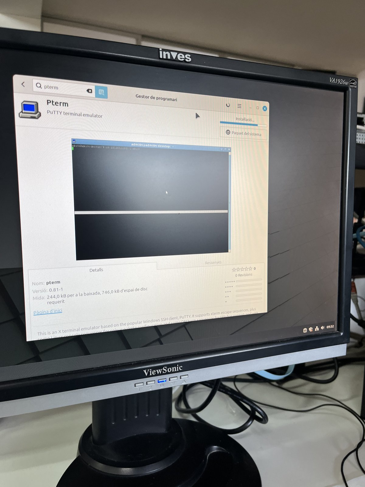
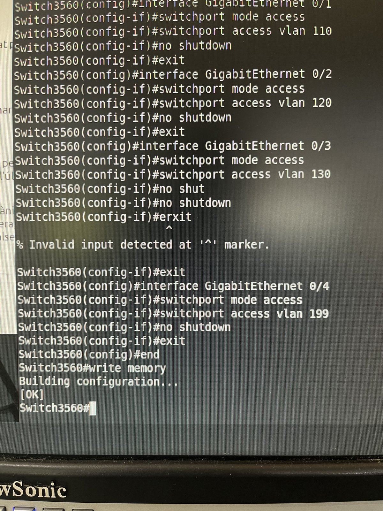

# 📓 Bitàcora setmanal

Bitácora conjunta del grupo **Sede València**. Cada semana recoge el objetivo, los pasos seguidos
(con capturas) y el resultado. Los diarios individuales están en esta misma carpeta
(p. ej. [Noe.md](./Noe.md)).

## Índice

| Semana | Contenido | Estado |
|---|---|---|
| [Setmana 1](#setmana-1) | Organització del grup i assignació de rols | ✅ Completada |
| [12-18 de octubre](#semana-12-18-de-octubre) | Práctica 2: router, Proxmox y VLANs | ✅ Completada |
| [19-25 de octubre](#semana-19-25-de-octubre) | Práctica 3: máquina virtual Ubuntu en Proxmox | ✅ Completada |
| [2-6 de noviembre](#semana-2-6-de-noviembre) | Máquinas virtuales: Ubuntu Server, Linux Mint y Windows Server 2025 | 🟡 En curso |

### 🌐 Datos de red de la sede

Referencia rápida extraída del [esquema de red](../Imgs/p2-03-esquema-vlan.jpg) y de la configuración del switch.

| VLAN | Departamento | Red | Gateway (SVI del switch) | Puerto de acceso |
|---|---|---|---|---|
| 110 | Servidors | `10.1.10.0/24` | `10.1.10.1` | Gi0/1 |
| 120 | Comercial | `10.1.20.0/24` | `10.1.20.1` | Gi0/2 |
| 130 | Administració | `10.1.30.0/24` | `10.1.30.1` | Gi0/3 |
| 199 | Gestió | `10.1.99.0/24` | `10.1.99.1` | Gi0/4 |

- **Red de la sede:** `10.1.0.0/16`
- **Servidor Proxmox:** hostname `sede`, IP `10.1.10.2/24` (VLAN 110 · Servidors)

---

## Setmana 1

> **Organització del grup i assignació de rols**

### 🎯 Objectiu

Organitzar el grup de treball i assignar els diferents rols per a començar el projecte.

### 🛠️ Treball realitzat

Durant aquesta primera setmana ens hem centrat en l'organització inicial del grup.
Hem revisat els diferents rols que hi havia dins del projecte i les funcions de cadascun:

- Cap de projecte
- Secretari
- Responsable tècnic

També hem decidit els substituts de cada rol.

Com que al principi no ens posàvem d'acord sobre l'assignació dels rols, vam decidir fer-ho mitjançant un **sorteig** per a repartir-los de manera aleatòria.

| Rol | Titular | Substitut |
|---|---|---|
| Cap de projecte | Noé Guerola Mas | Alex Martínez Hervás |
| Secretari | Miquel Ibor Lurbe | Adrián Martínez García |
| Responsable tècnic | Abdellah Bourass Et Taibi | Daniel Albelda Bonete |

### ✅ Què hem aconseguit

- Organitzar el grup de treball.
- Assignar els tres rols principals.
- Assignar un substitut per a cada rol.
- Deixar preparada l'organització inicial per començar el projecte.

### ❌ Què no hem aconseguit i per què

Durant aquesta primera setmana no hem avançat en altres parts del projecte, ja que ens hem centrat en l'organització inicial i en l'assignació dels rols.

---

## Semana 12-18 de octubre

> **Práctica 2: instalación de Proxmox, configuración de IPs y switching del laboratorio**

### 🎯 Objetivo

Instalar Proxmox, estudiar y configurar el direccionamiento IP de la sede y resolver el switching del laboratorio creando las VLAN en el switch Cisco Catalyst 3560.

### Paso 1 · Conexión al router

Lo primero es conectarnos al router por consola para verificar las interfaces y comprobar que todo responde correctamente antes de conectarnos a Proxmox.

<p align="center">
  
</p>

> 💡 Para la conexión por consola también instalamos el emulador de terminal PuTTY (`pterm`):
>
> <p align="center">
>   
> </p>

### Paso 2 · Configuración de red en Proxmox

Durante la instalación de Proxmox asignamos la configuración de red del servidor:

| Opción | Valor |
|---|---|
| Hostname | `sede` |
| Interfaz de gestión | `nic2` |
| IP | `10.1.10.2/24` |
| DNS | `8.8.8.8` |
| Sistema de ficheros | ext4 en `/dev/sda` |

<p align="center">
  
</p>

### Paso 3 · Direccionamiento de las VLAN

Revisamos las direcciones IP que tendrá cada VLAN antes de configurarlas en el switch (ver [tabla de red](#-datos-de-red-de-la-sede)).

<p align="center">
  
</p>

### Paso 4 · Acceso al switch

Nos conectamos al switch por Telnet para poder configurar nuestras VLAN.

<p align="center">
  
</p>

### Paso 5 · Creación y direccionamiento de las VLAN

Creamos las VLAN 110 (Servidors), 120 (Comercial), 130 (Administració) y 199 (Gestió), y asignamos a cada interfaz VLAN su dirección IP.

```text
vlan 110
 name Servidors
vlan 120
 name Comercial
vlan 130
 name Administracio
vlan 199
 name Gestio
!
interface vlan 110
 ip address 10.1.10.1 255.255.255.0
 no shutdown
interface vlan 120
 ip address 10.1.20.1 255.255.255.0
 no shutdown
interface vlan 130
 ip address 10.1.30.1 255.255.255.0
 no shutdown
interface vlan 199
 ip address 10.1.99.1 255.255.255.0
 no shutdown
```

<p align="center">
  
</p>

<p align="center">
  
</p>

### Paso 6 · Comprobación de las VLAN

Con `show vlan brief` comprobamos que todas las VLAN se han creado correctamente y que están activas.

<p align="center">
  
</p>

### Paso 7 · Comprobación de las interfaces

Con `show ip interface brief` verificamos la IP y el estado de cada interfaz del switch.

<p align="center">
  
</p>

### Paso 8 · Asignación de puertos y guardado

Asignamos los puertos GigabitEthernet 0/1 a 0/4 en modo acceso a las VLAN 110, 120, 130 y 199, y guardamos la configuración con `write memory`.

```text
interface GigabitEthernet 0/1
 switchport mode access
 switchport access vlan 110
 no shutdown
interface GigabitEthernet 0/2
 switchport mode access
 switchport access vlan 120
 no shutdown
interface GigabitEthernet 0/3
 switchport mode access
 switchport access vlan 130
 no shutdown
interface GigabitEthernet 0/4
 switchport mode access
 switchport access vlan 199
 no shutdown
end
write memory
```

<p align="center">
  
</p>

<p align="center">
  
</p>

### ✅ Resultado

- Proxmox instalado en el servidor `sede` con la IP `10.1.10.2/24`.
- Cuatro VLAN creadas en el switch, cada una con su interfaz y su IP.
- Puertos Gi0/1-Gi0/4 asignados a su VLAN y configuración guardada.

---

## Semana 19-25 de octubre

> **Práctica 3: creación de una máquina virtual Ubuntu en Proxmox**

### 🎯 Objetivo

Crear una máquina virtual en Proxmox, preparar la imagen ISO de Ubuntu y configurar los parámetros necesarios para su instalación.

| Parámetro | Valor |
|---|---|
| ID / nombre | `100` · `Ubuntu-Cliente` |
| Nodo | `sede` |
| ISO | Ubuntu 25.04 |
| Firmware | OVMF (UEFI) + disco EFI |
| Controlador | VirtIO SCSI |
| Disco | 32 GB en `local-lvm` |

### Paso 1 · Acceso a Proxmox

Accedemos al panel de administración de Proxmox con el usuario root para gestionar el servidor y comenzar la práctica.

<p align="center">
  
</p>

### Paso 2 · Subida de la ISO

Dentro de Proxmox, accedemos al almacenamiento local para subir la imagen ISO de Ubuntu 25.04, que utilizaremos para instalar el sistema operativo.

<p align="center">
  
</p>

### Paso 3 · Creación de la máquina virtual

Creamos una nueva máquina virtual con el identificador 100 y el nombre Ubuntu-Cliente dentro del nodo sede.

<p align="center">
  
</p>

### Paso 4 · Selección de la ISO

Seleccionamos la imagen ISO de Ubuntu que hemos subido y configuramos el tipo de sistema operativo como Linux con la versión correspondiente.

<p align="center">
  
</p>

### Paso 5 · Configuración del sistema

Seleccionamos el firmware OVMF (UEFI), mantenemos el controlador VirtIO SCSI y activamos el disco EFI necesario para el arranque.

<p align="center">
  
</p>

### Paso 6 · Configuración del disco

Por último, configuramos el disco duro virtual con 32 GB en el almacenamiento local-lvm y el controlador VirtIO SCSI.

<p align="center">
  
</p>

### ✅ Resultado

- Máquina virtual `100 · Ubuntu-Cliente` creada y lista para instalar Ubuntu 25.04.

---

## Semana 2-6 de noviembre

> **Instalación de las máquinas virtuales de la sede**

### 🎯 Objetivo

Instalar y configurar en Proxmox las tres máquinas virtuales de la sede.

### 🛠️ Trabajo realizado

| Máquina virtual | Función | Estado |
|---|---|---|
| Ubuntu Server | Servidor Linux | 🟡 Configuración en curso |
| Linux Mint | Cliente Linux | 🟡 Configuración en curso |
| Windows Server 2025 | Servidor Windows | 🟠 Con incidencias |

### ⚠️ Problemas encontrados

| Problema | Detalle | Estado |
|---|---|---|
| Controlador de discos | El instalador de Windows Server 2025 no detectaba los discos. | En revisión |
| Formateo de discos | Dificultades para formatear los discos mediante directivas de Windows. | En revisión |

### 📌 Pendiente

- [ ] Terminar la configuración de Ubuntu Server.
- [ ] Terminar la configuración de Linux Mint.
- [ ] Resolver las incidencias de discos y terminar la configuración de Windows Server 2025.
- [ ] Añadir las capturas de esta semana a `Imgs/` (formato `p4-NN-descripcion.jpg`).
