# 📓 Bitàcora setmanal

## Índice

- [Setmana 1 · Organització del grup](#setmana-1)
- [Semana 12-18 de octubre · Práctica 2: router, Proxmox y VLANs](#semana-12-18-de-octubre)
- [Semana 19-25 de octubre · Máquina virtual Ubuntu en Proxmox](#semana-19-25-de-octubre)

---

## Setmana 1

> **Organització del grup i assignació de rols**

### Objectiu del grup

Organitzar el grup de treball i assignar els diferents rols per a començar el projecte.

### Treball realitzat

Durant aquesta primera setmana ens hem centrat en l'organització inicial del grup.
Hem revisat els diferents rols que hi havia dins del projecte i les funcions de cadascun:

- Cap de projecte
- Secretari
- Responsable tècnic

També hem decidit els substituts de cada rol.

Com que al principi no ens posàvem d'acord sobre l'assignació dels rols, vam decidir fer-ho mitjançant un sorteig per a repartir-los de manera aleatòria.

Finalment, els rols van quedar assignats entre els membres del grup.

### Què hem aconseguit

- Organitzar el grup de treball.
- Assignar els tres rols principals.
- Assignar un substitut per a cada rol.
- Deixar preparada l'organització inicial per començar el projecte.

### Què no hem aconseguit i per què

Durant aquesta primera setmana no hem avançat en altres parts del projecte, ja que ens hem centrat en l'organització inicial i en l'assignació dels rols.

---

## Semana 12-18 de octubre

> **Práctica 2: instalación de Proxmox, configuración de IPs y switching del laboratorio**

Esta semana hemos hecho la práctica 2, en la que hemos instalado Proxmox, estudiado y configurado el direccionamiento IP y resuelto el switching del laboratorio.

### Paso 1 · Conexión al router

Lo primero es conectarnos al router por consola para verificar las interfaces y comprobar que todo responde correctamente antes de conectarnos a Proxmox.

  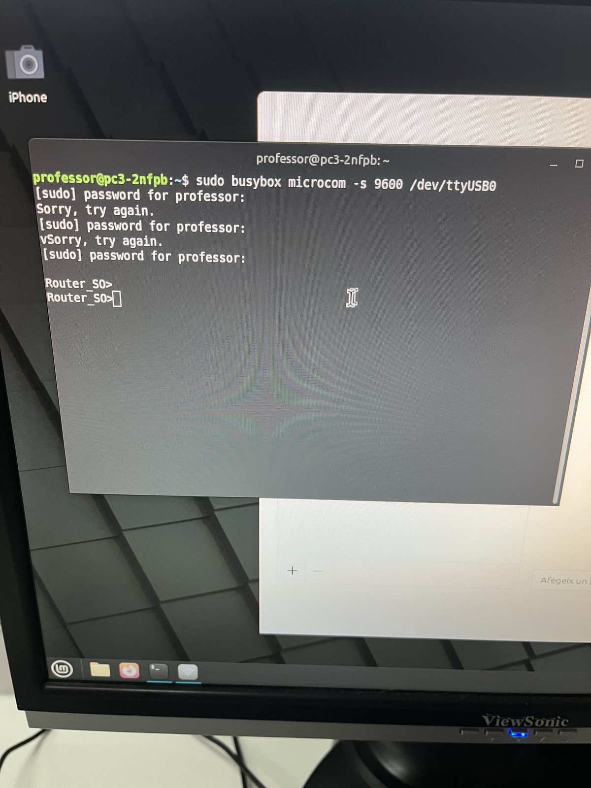

### Paso 2 · Configuración de red en Proxmox

Entramos en la configuración de Proxmox para asignar la IP que debe tener nuestro servidor.

  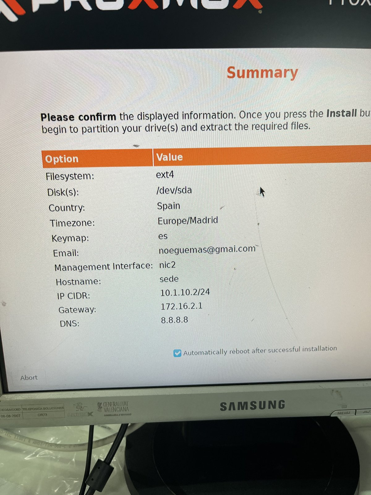

### Paso 3 · Direccionamiento de las VLAN

Revisamos las direcciones IP que tendrá cada VLAN antes de configurarlas en el switch.

  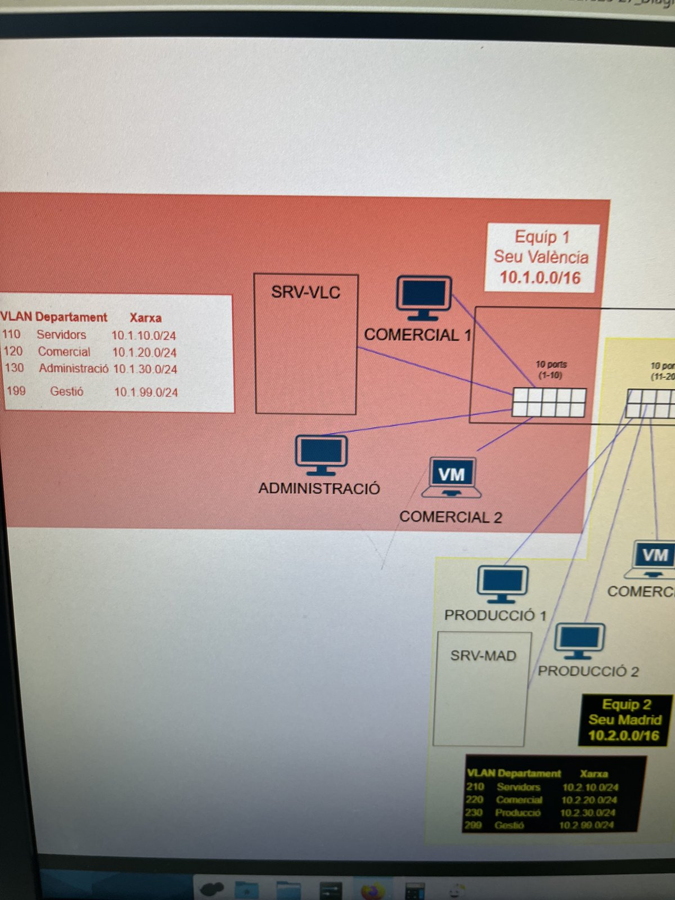

### Paso 4 · Acceso al switch

Nos conectamos al switch por Telnet para poder configurar nuestras VLAN.

  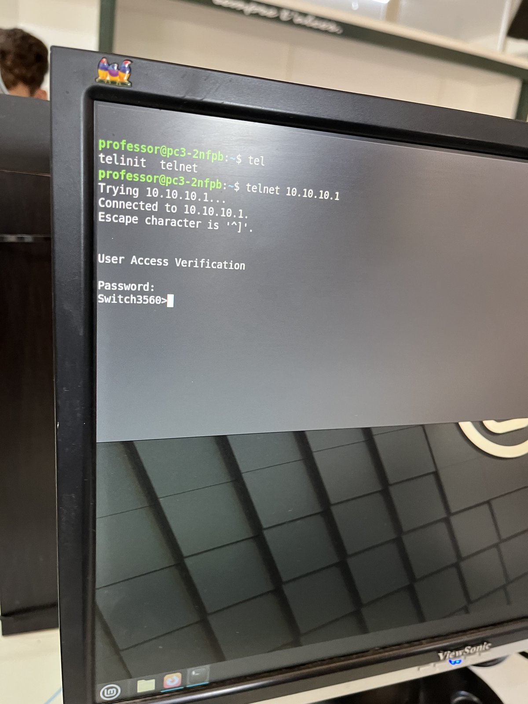

### Paso 5 · Creación y direccionamiento de las VLAN

Creamos las VLAN 110 (Servidors), 120 (Comercial), 130 (Administració) y 199 (Gestió), y asignamos a cada interfaz VLAN su dirección IP.

  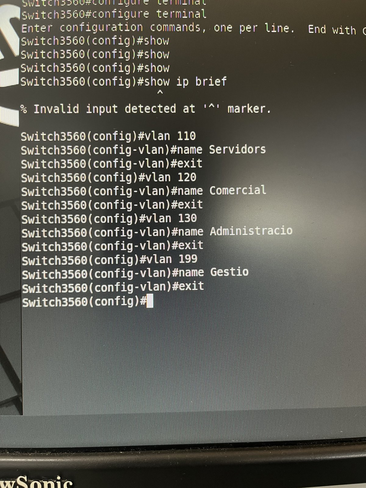

  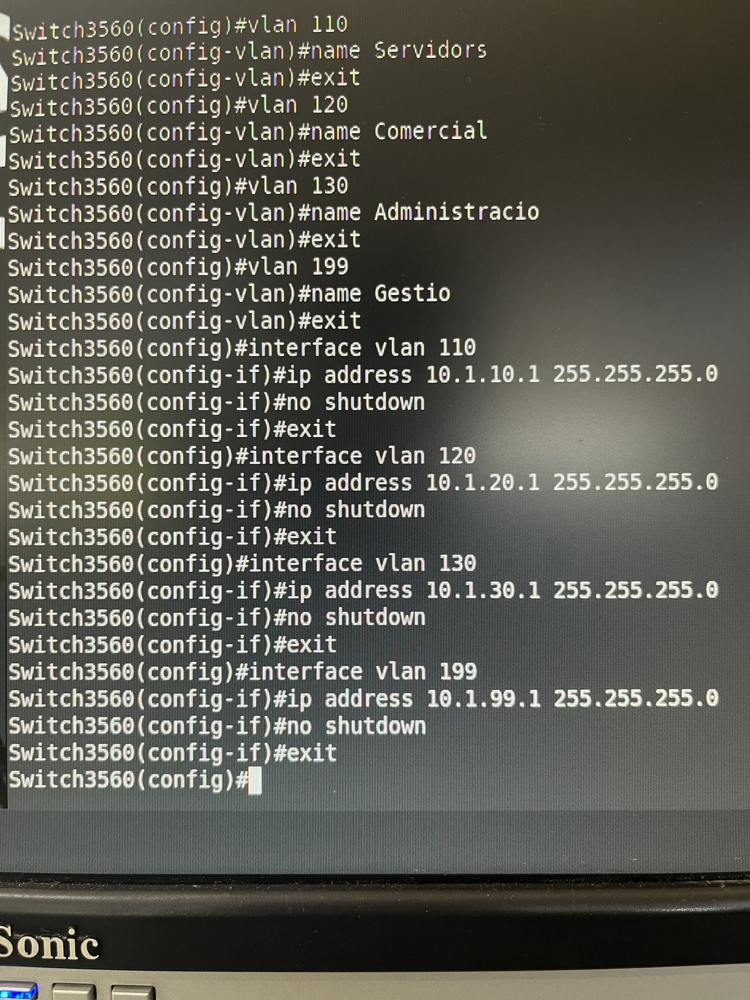

### Paso 6 · Comprobación de las VLAN

Con `show vlan brief` comprobamos que todas las VLAN se han creado correctamente y que están activas.

  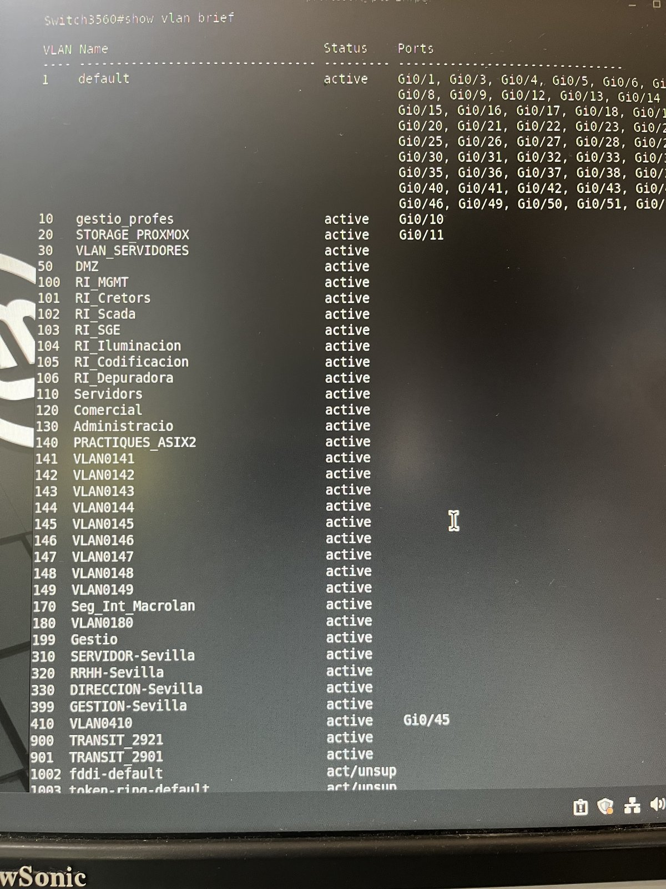

### Paso 7 · Comprobación de las interfaces

Con `show ip interface brief` verificamos la IP y el estado de cada interfaz del switch.

  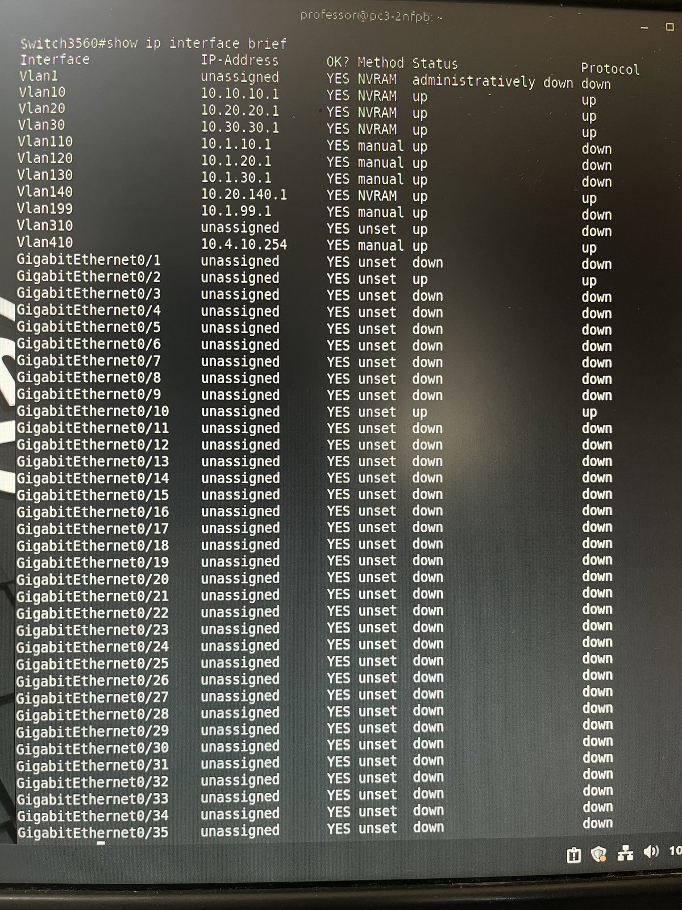

### Paso 8 · Asignación de puertos y guardado

Asignamos los puertos GigabitEthernet 0/1 a 0/4 en modo acceso a las VLAN 110, 120, 130 y 199, y guardamos la configuración con `write memory`.

  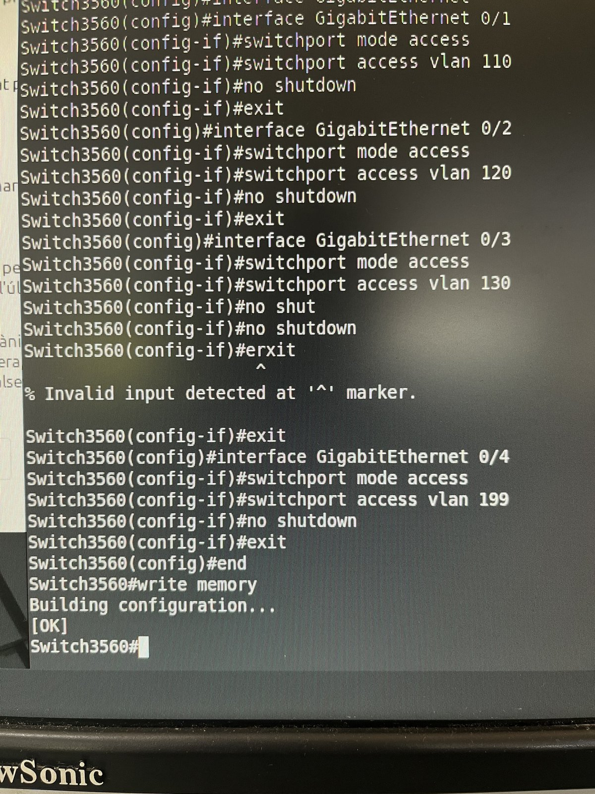

---

## Semana 19-25 de octubre

> **Creación de una máquina virtual Ubuntu en Proxmox**

Durante esta semana hemos continuado trabajando con Proxmox. Hemos creado una máquina virtual, preparado la imagen ISO de Ubuntu y configurado los parámetros necesarios para su instalación.

### Paso 1 · Acceso a Proxmox

Accedemos al panel de administración de Proxmox con el usuario root para gestionar el servidor y comenzar la práctica.

  

### Paso 2 · Subida de la ISO

Dentro de Proxmox, accedemos al almacenamiento local para subir la imagen ISO de Ubuntu 25.04, que utilizaremos para instalar el sistema operativo.

  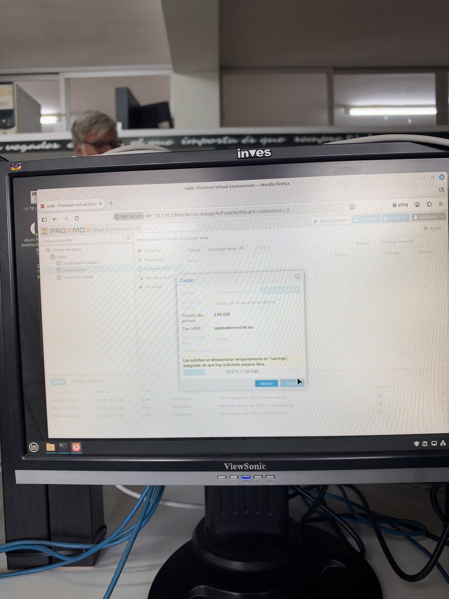

### Paso 3 · Creación de la máquina virtual

Creamos una nueva máquina virtual con el identificador 100 y el nombre Ubuntu-Cliente dentro del nodo sede.

  

### Paso 4 · Selección de la ISO

Seleccionamos la imagen ISO de Ubuntu que hemos subido y configuramos el tipo de sistema operativo como Linux con la versión correspondiente.

  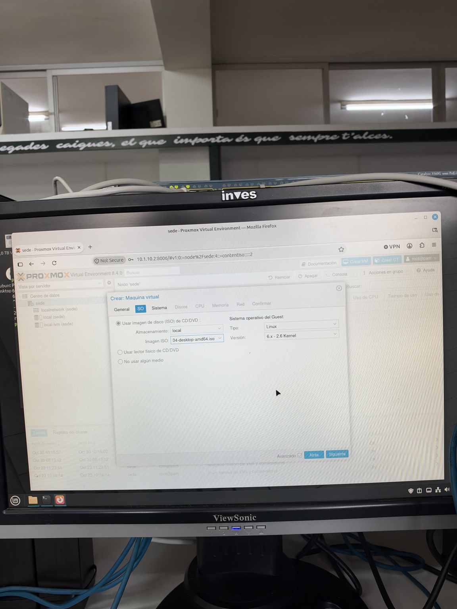

### Paso 5 · Configuración del sistema

Seleccionamos el firmware OVMF (UEFI), mantenemos el controlador VirtIO SCSI y activamos el disco EFI necesario para el arranque.

  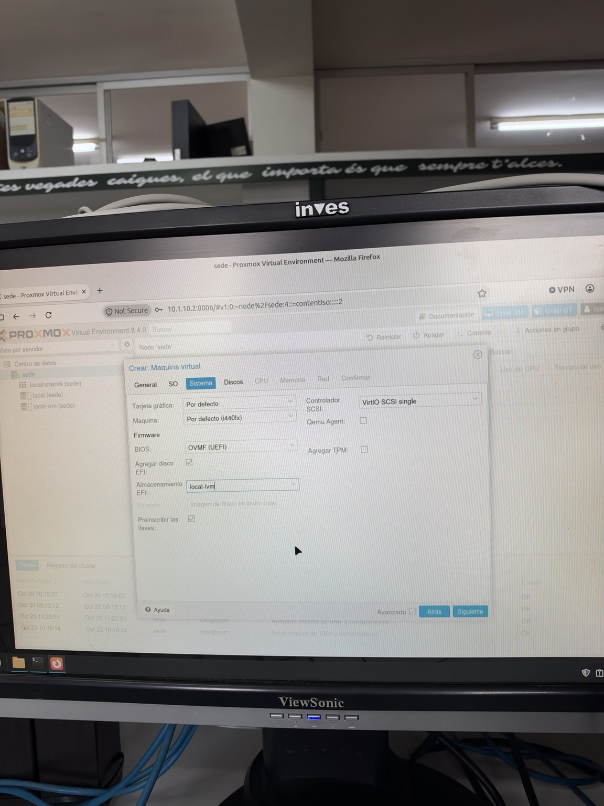

### Paso 6 · Configuración del disco

Por último, configuramos el disco duro virtual con 32 GB en el almacenamiento local-lvm y el controlador VirtIO SCSI.

  

